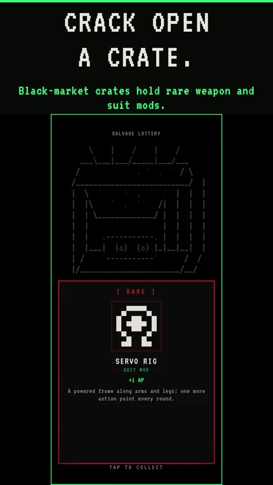

The Outer Darkness is out now on the App Store for iPhone and iPad, and it's free. A week after launch on Google Play, it's now on both stores.

## Get it

[Download The Outer Darkness on the App Store](https://apps.apple.com/us/app/the-outer-darkness-sci-fi-rpg/id6824474398). If you pre-ordered, it's already downloading to your iPhone or iPad on its own, so check your home screen.

On Android, it's [on Google Play](https://play.google.com/store/apps/details?id=tech.hiddenproject.theouterdarkness).

## What you're boarding

Dead ships drift back out of the dark with their holds full and their crews still aboard.

- **Scan** the dark for derelicts, each with its size, threat and conditions: low oxygen, darkness, infestations.
- **Board** a new seeded ship every run, with fights, loot, supplies and rooms where something on the comms asks to be let in.
- **Fight** in turn-based rounds, aiming each shot at a body part. Blind a Stalker, cripple a Crawler's legs, crack a Warden's shell.
- **Get out** with whatever you can carry. Die, and everything you brought stays aboard.
- **Upgrade** your ship with the salvage, and go back out.

A boarding takes 5 to 15 minutes, it's played one-handed in portrait, and a run saves when you stop. There's no pay-to-win.

## Tell me what you think

Found a bug, or a ship that feels unfair? Write to [support@hiddenproject.tech](mailto:support@hiddenproject.tech), or leave a rating and review on the App Store. Screenshots and the rest are on the [game page](/the-outer-darkness/).
