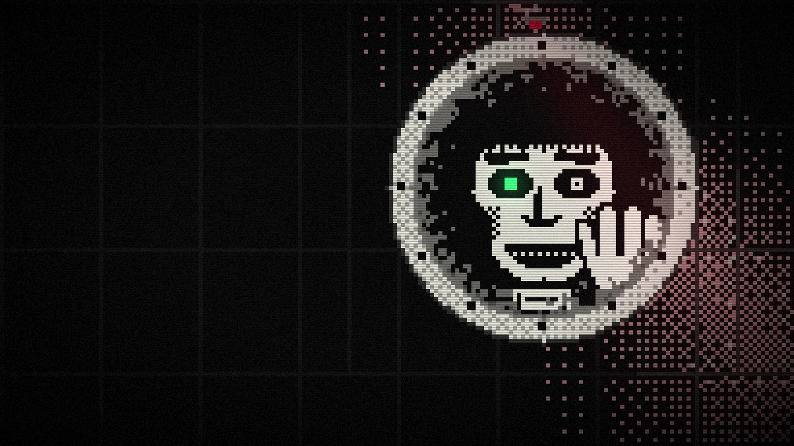

Update 2.0, Survivors, comes to The Outer Darkness on December 7, on Google Play and the App Store. It's the biggest update yet: the people you find aboard a wreck can now come home with you, and your ship has days of its own between runs.

## Bring them home

Somewhere aboard a derelict, someone is still breathing. There's one seat on the shuttle. Take them with you, and they can be hit, or turn, before you reach the exit.

## Check their story at the airlock

Back on your ship, nobody comes in until you've checked them. Hold what they say against the crew manifest you found, scan them, test their blood, and decide: **admit**, **quarantine**, or **the airlock**. A lie isn't proof of infection, and a trait can look like a symptom.

## Your ship, between runs

- **The day aboard.** Your crew eat, work, fall out and fall ill. Keep the rations, the power and the air going.
- **Infection** shows one symptom at a time. Let the wrong one in, and it turns in your bunks.
- **Crises**: a breach you seal by hand, a brownout, a theft, a fire.

## New on the derelicts

- **Boss ships** that end in the Shepherd, a two-phase boss.
- **Hazards, locks and terminals** you play by hand. A miss costs you, not the run.
- **Experiments**: a bench where samples and salvage mix into unique items. Some mixes go wrong.
- **A guided first boarding** for new players.

Everything in 2.0 is free. Nothing resets, nothing is sold, and it all plays offline, in English, Russian, Spanish and Turkish.

## Get ready

Already playing? The update arrives on December 7 like any other, so keep the game updated. New here? Get The Outer Darkness on [Google Play](https://play.google.com/store/apps/details?id=tech.hiddenproject.theouterdarkness) or the [App Store](https://apps.apple.com/us/app/the-outer-darkness-sci-fi-rpg/id6824474398), and there are two weeks of boarding to learn the ships first.

Same day, The Tower comes to iPhone, and it's [open for pre-order](/blog/the-tower-app-store-pre-order/) now.
