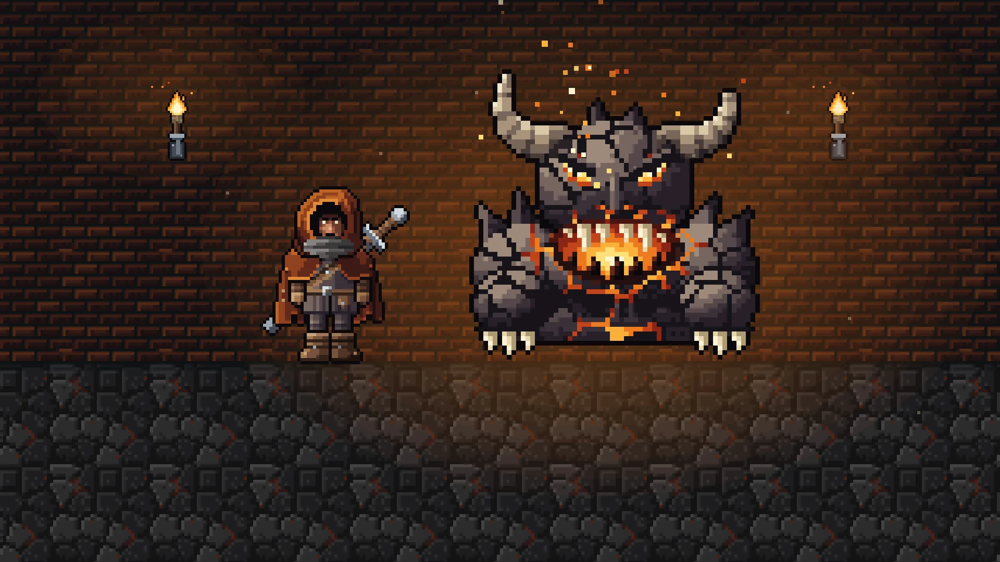

The Tower is coming to iPhone. It's open for pre-order on the App Store now, and it's expected on December 7.

## How a pre-order works

Open [The Tower: Idle RPG on the App Store](https://apps.apple.com/us/app/the-tower-idle-rpg/id6832433757) and tap **Pre-Order**. The game is free, so there's nothing to pay. On launch day it downloads to your iPhone on its own.

On Android, it's already out [on Google Play](https://play.google.com/store/apps/details?id=tech.hiddenproject.thetower).

## What you're climbing

An endless tower with a fight on every floor.

- **Fight** in turn-based rounds: spend energy, watch your cooldowns, and interrupt the big hit a gate boss telegraphs before it lands.
- **Choose a door.** Three open after every fight, through five biomes from the Ashlands to the Obsidian Gate. The safe door pays less.
- **Climb while you're away.** Gold piles up for hours with the game closed, and the floor's materials go straight into your stores.
- **Rest in a Haven** every ten floors, with a trainer, a shop and a rumour about the next gate boss.
- **Solve the lairs** behind gates 10 and 60: levers, blocks and locks, three chambers, and a vault with the gate's rare. Season 1, the Belfry, is the Bellwright's lair at gate 60.

No account and no internet needed. No premium currency, no energy timers, and no way to pay your way past a fight. It's in English, Russian, Spanish and Turkish.

The [first post](/blog/the-tower-endless-climb/) has more about the climb, and the [game page](/the-tower/) has the screenshots.
